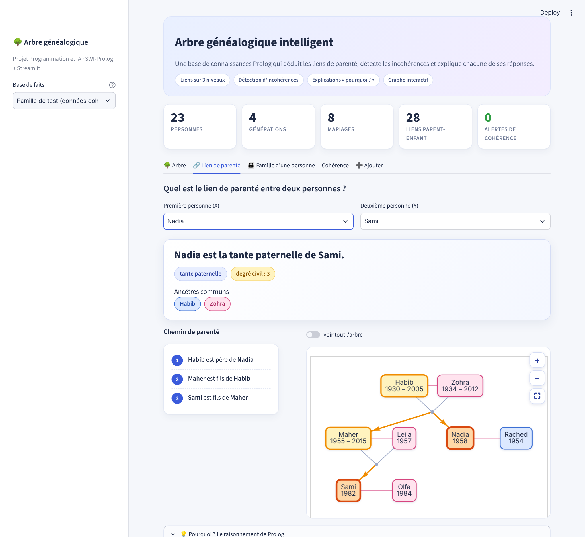
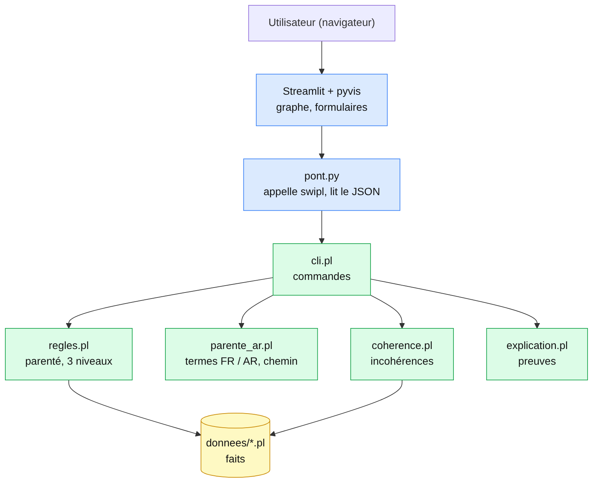
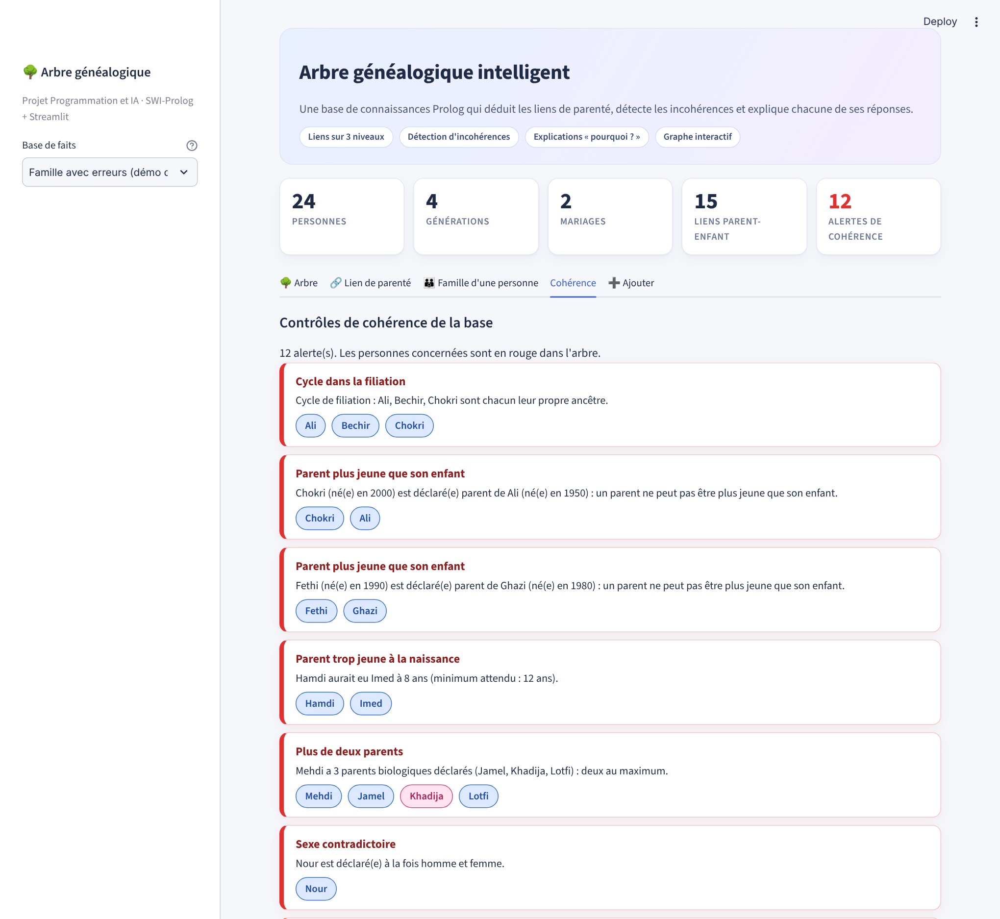
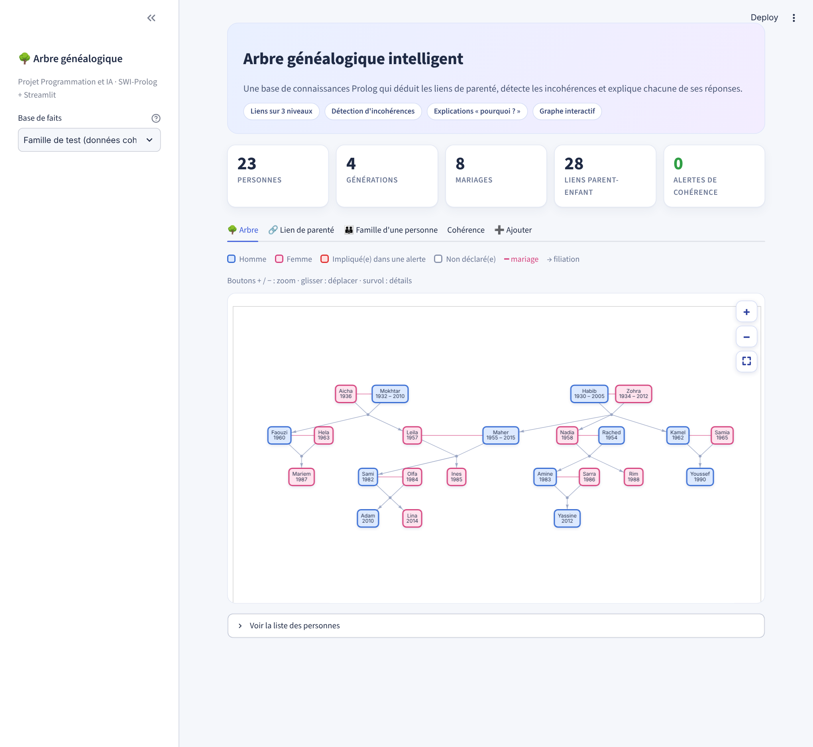
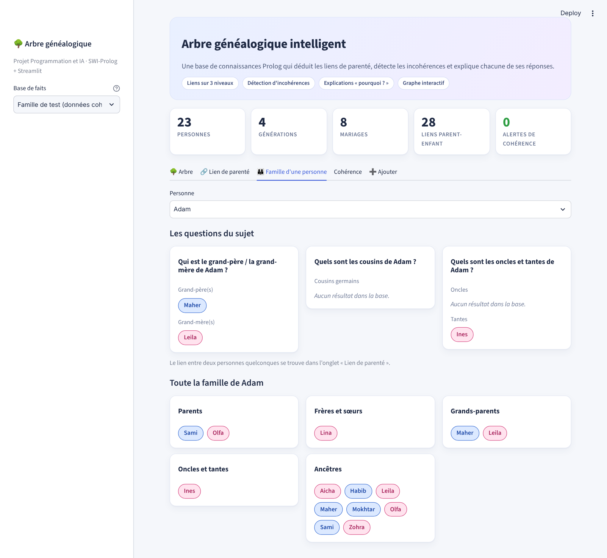

# Système intelligent d'analyse des arbres généalogiques

Base de connaissances en **SWI-Prolog** qui déduit les liens de parenté, **détecte les incohérences** dans les données et **explique chacune de ses réponses**, avec une interface web interactive.

> Projet de la matière _Programmation et Intelligence Artificielle_ — Master Recherche en Informatique et Réseaux (MRIR), FSG, 2026-2027.
> **Auteurs :** Issra Saidi · Etienne GOUDJANOUSSI : https://github.com/GoGnEt1



---

## Sommaire

1. [Contexte et objectifs](#1-contexte-et-objectifs)
2. [Fonctionnalités](#2-fonctionnalités)
3. [Architecture](#3-architecture)
4. [Modèle de connaissances](#4-modèle-de-connaissances)
5. [Raisonnement à trois niveaux](#5-raisonnement-à-trois-niveaux)
6. [Détection d'incohérences](#6-détection-dincohérences)
7. [Explication des réponses](#7-explication-des-réponses)
8. [Interface utilisateur](#8-interface-utilisateur)
9. [Installation et exécution](#9-installation-et-exécution)
10. [Tests](#10-tests)
11. [Structure du dépôt](#11-structure-du-dépôt)
12. [Choix de conception, limites et perspectives](#12-choix-de-conception-limites-et-perspectives)
13. [Sources et licences](#13-sources-et-licences)
14. [Répartition du travail](#14-répartition-du-travail)

---

## 1. Contexte et objectifs

Les dépôts open source consacrés aux arbres généalogiques en Prolog se limitent le plus souvent à calculer des relations (père, frère, cousin) sur une famille fixe, sans interface et sans contrôle de la qualité des données. Notre projet vise un système plus complet, construit autour de trois idées :

| Axe                               | Ce que nous apportons                                                                                                                                                |
| --------------------------------- | -------------------------------------------------------------------------------------------------------------------------------------------------------------------- |
| **Raisonnement multi-niveaux**    | Relations directes, dérivées (oncles, cousins, alliés) et récursives (ancêtres, degré de cousinage, chemin de parenté).                                              |
| **Détection d'incohérences**      | 12 contraintes (cycles, âges impossibles, mariages interdits, références inconnues…) qui signalent les erreurs de saisie avec un message lisible.                    |
| **Explications et visualisation** | Un méta-interpréteur rejoue la preuve d'un résultat (« pourquoi X est la tante de Y ? ») et un graphe interactif met en valeur le chemin et les personnes en erreur. |

Le français distingue le côté paternel du côté maternel (un _oncle paternel_ n'est pas un _oncle maternel_) ; le moteur en tient compte dans tous ses prédicats.

## 2. Fonctionnalités

| Fonctionnalité         | Détail                                                                                                                    |
| ---------------------- | ------------------------------------------------------------------------------------------------------------------------- |
| Questions du sujet     | « Qui est le grand-père de X ? », « Quels sont les cousins de X ? », « Quel est le lien entre X et Y ? »                  |
| Lien de parenté        | Phrase de réponse, degré civil, degré de cousinage, ancêtres communs, plus court chemin.                                  |
| Famille d'une personne | Parents, fratrie, conjoint, enfants, grands-parents, oncles et tantes, cousins, neveux, ancêtres, descendants.            |
| Cohérence              | Alertes détaillées, personnes concernées colorées en rouge dans l'arbre.                                                  |
| Explication            | Arbre de preuve traduit en phrases, bouton « Pourquoi ? ».                                                                |
| Enrichissement         | Ajout d'une personne, d'un lien parent-enfant ou d'un mariage depuis l'interface, avec contrôle immédiat de la cohérence. |

## 3. Architecture



Le raisonnement est **entièrement en Prolog** ; Python n'affiche que les résultats. Les deux parties communiquent par un contrat JSON documenté dans [`docs/contrat_json.md`](docs/contrat_json.md) :

```
swipl cli.pl -- <fichier_faits> <commande> [arguments]
```

| Commande             | Rôle                                                             |
| -------------------- | ---------------------------------------------------------------- |
| `graphe`             | personnes, liens, alertes et statistiques (ouverture de la page) |
| `alertes`            | contrôles de cohérence                                           |
| `relation X Y`       | lien entre deux personnes, chemin et explication                 |
| `expliquer X Y`      | raisonnement détaillé                                            |
| `liste <relation> X` | toutes les personnes liées à X par une relation donnée           |

## 4. Modèle de connaissances

```prolog
personne(Id, Nom, Sexe, AnneeNaissance, AnneeDeces).  % Sexe : h | f ; AnneeDeces : année ou vivant
parent(Parent, Enfant).                                % lien biologique
conjoint(X, Y).                                        % mariage, déclaré une seule fois
```

Convention de lecture : `relation(X, Y)` signifie « X est le/la _relation_ de Y » (`pere(maher, sami)` : Maher est le père de Sami). La symétrie du mariage est gérée dans les règles.

Deux jeux de données :

- `donnees/famille.pl` : famille de test **cohérente** (23 personnes, 4 générations, 8 mariages) couvrant grands-parents paternels et maternels, oncles de sang et par alliance, cousins germains et issus de germains.
- `donnees/famille_erreurs.pl` : données **volontairement fausses**, une erreur par code de cohérence.

## 5. Raisonnement à trois niveaux

Défini dans `regles.pl`. Le fichier ne contient aucun fait : il se charge avec un jeu de données.

| Niveau             | Relations                                                                                                                                                                           |
| ------------------ | ----------------------------------------------------------------------------------------------------------------------------------------------------------------------------------- |
| **1 — directes**   | parent, enfant, frère, sœur, demi-fratrie, conjoint                                                                                                                                 |
| **2 — dérivées**   | grands-parents, oncles et tantes (paternels / maternels, de sang et par alliance), neveux et nièces, cousins germains, beaux-parents, gendres et brus, beaux-frères et belles-sœurs |
| **3 — récursives** | ancêtres, descendants, degré de cousinage (germains, issus de germains…), ancêtres communs, plus court chemin de parenté                                                            |

Exemples dans l'interpréteur :

```prolog
swipl donnees/famille.pl regles.pl coherence.pl
?- cousin_germain(X, sami).
?- chemin(sami, hela, P).
```

## 6. Détection d'incohérences

Défini dans `coherence.pl`, par contraintes. Seuils paramétrables : âge minimal d'un parent (12 ans), longévité maximale (120 ans).

| Code                         | Situation détectée                                       |
| ---------------------------- | -------------------------------------------------------- |
| `cycle`                      | une personne est son propre ancêtre                      |
| `parent_plus_jeune`          | un parent né la même année que son enfant, ou après      |
| `parent_trop_jeune`          | un parent de moins de 12 ans à la naissance de l'enfant  |
| `trop_de_parents`            | plus de deux parents biologiques                         |
| `sexe_contradictoire`        | une personne déclarée à la fois homme et femme           |
| `deces_avant_naissance`      | décès antérieur à la naissance                           |
| `naissance_apres_deces_mere` | enfant né après le décès de sa mère                      |
| `naissance_apres_deces_pere` | enfant né plus d'un an après le décès de son père        |
| `longevite_impossible`       | durée de vie supérieure à 120 ans                        |
| `mariage_ascendant`          | mariage entre un ascendant et son descendant             |
| `mariage_fratrie`            | mariage entre frère et sœur (ou demi-frère et demi-sœur) |
| `reference_inconnue`         | lien citant une personne jamais déclarée                 |



## 7. Explication des réponses

`explication.pl` contient un **méta-interpréteur** : au lieu d'appeler directement une règle, `prouve/2` la rejoue clause par clause et note chaque fait utilisé. L'arbre de preuve obtenu est traduit en phrases. Pour « Nadia est la tante paternelle de Sami » :

1. Maher est le père de Sami.
2. Habib est le père de Nadia.
3. Habib est le père de Maher.
4. donc Nadia et Maher sont frère et sœur.
5. donc Nadia est frère ou sœur d'un parent de Sami.
6. Nadia est une femme.

## 8. Interface utilisateur

Application **Streamlit** (thème clair) avec graphe **pyvis** : une rangée par génération, couples côte à côte, point d'union d'où partent les filiations, personnes en alerte en rouge, boutons de zoom (+ / − / ajuster) et déplacement à la souris. Le graphe fonctionne hors ligne.

| Onglet                 | Contenu                                                                                                                                      |
| ---------------------- | -------------------------------------------------------------------------------------------------------------------------------------------- |
| Arbre                  | graphe de toute la famille et liste des personnes                                                                                            |
| Lien de parenté        | choix de deux personnes, réponse, chemin surligné, « Pourquoi ? »                                                                            |
| Famille d'une personne | questions du sujet et toute la famille proche                                                                                                |
| Cohérence              | une carte par alerte                                                                                                                         |
| Ajouter                | nouvelle personne, lien parent-enfant, mariage ; les faits ajoutés vont dans une copie temporaire, le fichier d'origine n'est jamais modifié |




## 9. Installation et exécution

**Prérequis :** [SWI-Prolog](https://www.swi-prolog.org/download/stable) (version 9 ou plus ; sous Windows, cocher _Add swipl to the system PATH_) et Python 3.10 ou plus.

```bash
git clone https://github.com/Issra21/arbre-genealogique.prolog.git
cd arbre-genealogique.prolog
```

**Windows (PowerShell)**

```powershell
py -m venv .venv
.\.venv\Scripts\Activate.ps1          # si bloqué : Set-ExecutionPolicy -Scope Process Bypass
pip install -r ui\requirements.txt
streamlit run ui\app.py               # http://localhost:8501
```

**Sans interface**

```bash
swipl cli.pl -- donnees/famille.pl graphe
swipl cli.pl -- donnees/famille.pl relation nadia sami
swipl cli.pl -- donnees/famille.pl liste cousin_germain sami
swipl cli.pl -- donnees/famille_erreurs.pl alertes
```

**Dépannage :** « SWI-Prolog introuvable » → rouvrir le terminal après installation ; accents illisibles dans la console Windows → `chcp 65001` ; au premier lancement Streamlit demande un e-mail → appuyer sur Entrée.

## 10. Tests

```powershell
tests\lancer_tests.bat                 # 108 tests plunit (Windows)
swipl -g run_tests -t halt tests/test_niveau1.pl   # un fichier à la fois
python tests\test_ui.py                # pont Python-Prolog, graphe, démarrage de l'application
```

| Fichier                                                 | Contenu                                                    |
| ------------------------------------------------------- | ---------------------------------------------------------- |
| `test_niveau1.pl`, `test_niveau2.pl`, `test_niveau3.pl` | règles de parenté par niveau                               |
| `test_coherence.pl`, `test_coherence_famille.pl`        | chaque contrainte et absence d'alerte sur la famille saine |
| `test_parente_explication.pl`                           | termes de parenté et méta-interpréteur                     |
| `test_cli.pl`                                           | contrat JSON de `cli.pl`                                   |
| `test_ui.py`                                            | pont, faits ajoutés, graphe autonome, application          |

## 11. Structure du dépôt

Organisation en couches : les données (faits), le moteur de raisonnement (Prolog), le contrat d'échange (JSON), puis la présentation (Python). Chaque couche ne dépend que de celle qui la précède.

```
arbre-genealogique.prolog/
│
├── donnees/                      COUCHE DONNÉES : base de faits
│   ├── famille.pl                  famille de test cohérente (23 personnes, 4 générations)
│   └── famille_erreurs.pl          données volontairement fausses (12 codes d'alerte)
│
├── regles.pl                     COUCHE RAISONNEMENT : règles de parenté sur 3 niveaux (A)
├── parente_ar.pl                 catalogue des termes de parenté et plus court chemin (A)
├── coherence.pl                  contraintes de cohérence, 12 codes d'alerte (A)
├── explication.pl                méta-interpréteur : arbres de preuve en français (A)
├── cli.pl                        COUCHE D'ÉCHANGE : commandes, sortie JSON sur stdout (A)
│
├── ui/                           COUCHE PRÉSENTATION (B)
│   ├── app.py                      application Streamlit : 5 onglets
│   ├── pont.py                     pont Python-Prolog : appel de swipl, lecture du JSON
│   ├── graphe.py                   mise en page de l'arbre (générations, couples, filiations)
│   ├── style.css                   thème clair
│   └── requirements.txt            dépendances Python (streamlit, pyvis)
│
├── .streamlit/config.toml        configuration du thème
│
├── tests/                        VALIDATION
│   ├── lancer_tests.bat            lance la suite plunit complète (Windows)
│   ├── test_niveau1.pl … 3.pl      règles de parenté, un fichier par niveau
│   ├── test_coherence*.pl          chaque contrainte, et absence d'alerte sur la famille saine
│   ├── test_parente_explication.pl termes de parenté et méta-interpréteur
│   ├── test_cli.pl                 contrat JSON de cli.pl
│   └── test_ui.py                  pont, faits ajoutés, graphe autonome, application (B)
│
└── docs/
    ├── contrat_json.md             spécification des échanges Prolog ↔ Python
    └── captures/                   copies d'écran et schéma d'architecture
```

## 12. Choix de conception, limites et perspectives

**Choix**

- **Prolog pour tout le raisonnement**, Python uniquement pour l'affichage : la logique reste vérifiable et testable indépendamment de l'interface.
- **Appel de `swipl` par sous-processus et JSON** plutôt que `pyswip` : aucune dépendance de version, installation simple sous Windows.
- **Contrat JSON écrit avant l'intégration**, ce qui a permis de développer les deux parties en parallèle.
- **Faits ajoutés dans une copie temporaire** : les données d'origine restent intactes.

**Limites**

- Filiation biologique uniquement (ni adoption ni familles recomposées détaillées) ; années seulement, pas de dates complètes.
- Les mariages n'ont pas d'année : pas de contrôle de chronologie sur les unions.
- Lisibilité du graphe validée sur des familles d'environ vingt-cinq personnes.

**Perspectives** : import GEDCOM, dates précises et chronologie des mariages, filiation adoptive, vocabulaire de parenté d'autres langues, sauvegarde des modifications.

## 13. Sources et licences

Aucun code open source n'a été copié : les dépôts ont servi à comprendre les choix de modélisation, puis tout a été réécrit.

| Dépôt                                                                        | Licence                 | Usage                                      |
| ---------------------------------------------------------------------------- | ----------------------- | ------------------------------------------ |
| [corleone-family-tree](https://github.com/joao-tinelli/corleone-family-tree) | Apache-2.0              | référence pour la liste des prédicats      |
| [prolog-family-relations](https://github.com/5x/prolog-family-relations)     | MIT                     | idée des relations d'alliance              |
| [FTWA_Prolog_Project](https://github.com/zehraozlen/FTWA_Prolog_Project)     | aucune licence affichée | idée de validation des mariages uniquement |

Bibliothèques : SWI-Prolog (BSD-2), Streamlit (Apache-2.0), pyvis (BSD-3).

## 14. Répartition du travail

| Partie                | Responsable | Contenu                                                                         |
| --------------------- | ----------- | ------------------------------------------------------------------------------- |
| **A — Moteur Prolog** | Issra Saidi | faits, règles, cohérence, explications, `cli.pl`, contrat JSON, tests Prolog    |
| **B — Interface**     | Etienne     | application Streamlit, graphe, pont Python, tests de l'interface                |
| **Commun**            | les deux    | validation du contrat, jeu de données, relecture croisée, rapport et soutenance |
